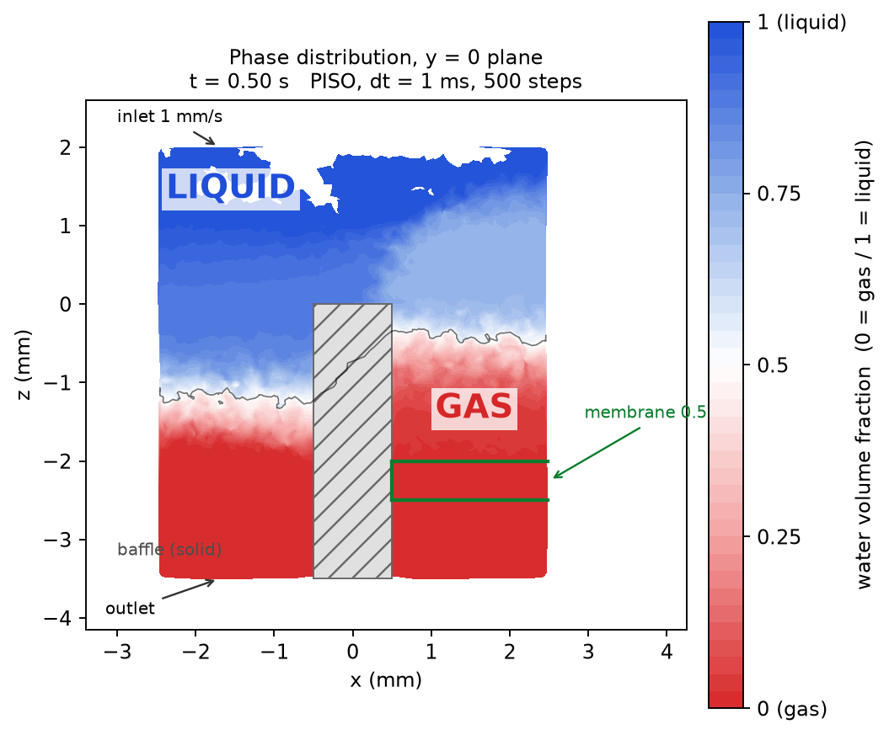

# Case2 — 透气防水膜（VOF 气液两相）

Fluent 19.2，3D 双精度，VOF 两相（air + water-liquid），瞬态。
膜以 **UDF 动量源项**（Darcy 阻力）实现"空气可过、水不可过"的相选择性阻挡。

## 几何（单位 mm）

| 部位 | 范围 |
|---|---|
| 圆柱域 | r = 2.5，z ∈ [−3.5, +2.0] |
| 中央实体隔板 | \|x\| ≤ 0.5，z ∈ [−3.5, 0]，无网格 |
| 困气浅腔 `small_fluid` | x > 0.5，z ∈ [−3.5, −2.5]，高 1.0 |
| 膜 `porous` | x > 0.5，z ∈ [−2.5, −2.0]，厚 0.5，面积 7.329 mm² |
| 入口 `inlet` | z = +2.0 整圆盘，19.62 mm² |
| 出口 `outlet` / `outlet2` | z = −3.5 左右两个弓形，各 7.329 mm² |

网格：130 408 四面体 / 25 795 节点 / 268 712 面，网格文件自带单位为 mm，
读入后 `/mesh/scale 0.001` 缩放到 m。

## 物理设置

- 主相 air：**constant 1.225 kg/m³**（等温，能量方程关闭）
- 次相 water-liquid：998.2 kg/m³
- 密度比 814.86
- 表面张力：CSF + Wall Adhesion，σ = 0.072 N/m，接触角 90°
- 重力 (0, 0, −9.81)，层流
- 压力-速度耦合：**PISO**；压力 PRESTO!；体积分数 Geo-Reconstruct；动量一阶迎风
- 入口：velocity-inlet，1 mm/s，water α = 1
- 出口：pressure-outlet 0 Pa，回流 water α = 0

## 膜的相选择性（`membrane.c`）

膜单元区挂三个 `DEFINE_SOURCE`（x/y/z 动量汇），Darcy 项：

```
S_i = -invK * mu * u_i
invK = (1 - alpha_water) * 1e13 + alpha_water * 1e16      [1/m²]
```

- 空气：K = 1e−13 m²（透气）
- 水：K = 1e−16 m²（等效不可渗透）
- 阻力系数相差约 5.6 万倍

`dS[eqn] = -invK*mu` 给了精确雅可比，源项完全隐式，膜不会被数值上冲穿。

编译：`libudf` 必须放在 Fluent 工作目录根下（Fluent 按 cwd 解析库名）。

## 运行

```
fluent 3ddp -g -t8 -i run_patch05.jou
```

时间推进用 `/solve/dual-time-iterate`（`/solve/iterate` 只是迭代、不推物理时间）。
dt = 1 ms，500 步 → 0.50 s。

先用 cell register `water` patch 液相（`/solve/patch` → phase-2 → water → mp = 1），
patch 后水体积 39.28 mm³。

## 结果（t = 0.50 s）

| 项 | 值 |
|---|---|
| 入口质量流量 | 1.9588e−5 kg/s |
| 残差 | continuity 2.5e−2，动量 ~3e−2，vf 2.5e−3 |
| 膜内 α_water | max 0.0036，平均 0.0002 |
| 困气腔 α_water | 0.0000 |
| 两相界面位置 | z ≈ −0.8 ~ −1.0 mm |



水（蓝）尚未压到膜面（膜顶 z = −2.0），膜下全为气（红），
因此该帧证明"膜下仍干燥"，但还不构成"水已被挡住"的判据 ——
需要继续推进约 1.0 s 让水锋抵达膜面。

## 文件

| 文件 | 说明 |
|---|---|
| `membrane.c` | 相选择性 Darcy 动量源项 UDF |
| `patch05.cas` | Fluent 算例（网格 + 全部设置） |
| `patch05.dat` | 对应数据，flow time = 0.50 s |
| `y0_phase.png` | y = 0 平面相图（红气／蓝液） |

## 已知问题

- 网格最小正交质量 0.138，长轴比 10.04，偏软；若要提高需重新划网格。
- 膜区未启用 Fluent 内置 Porous Zone（19.2 的 TUI 不暴露黏性/惯性阻力），
  因此孔隙率按 ε = 1 处理，阻力全部由 UDF 提供。
