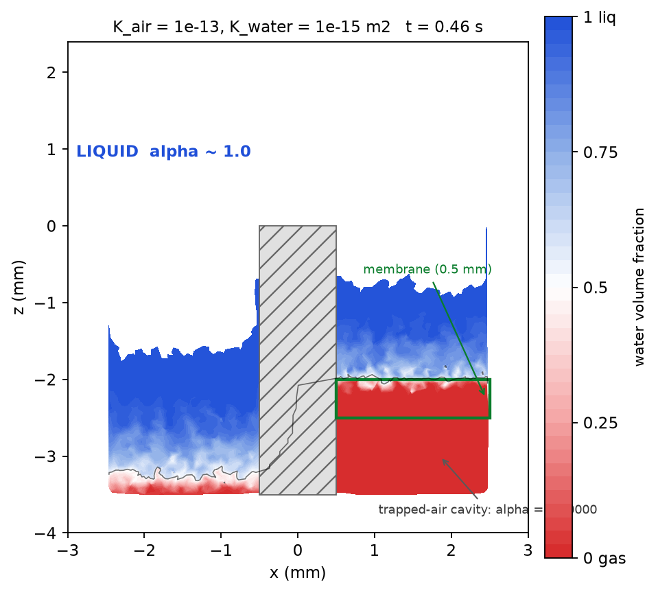

# Case2 — 透气防水膜（VOF 气液两相）

Fluent 19.2，3D 双精度，VOF 两相（air + water-liquid），瞬态。
膜以 **UDF 动量源项**（Darcy 阻力）实现"空气可过、水不可过"的相选择性阻挡。

## 几何（单位 mm）

| 部位 | 范围 |
|---|---|
| 圆柱域 | r = 2.5，z ∈ [−3.5, +2.0] |
| 中央实体隔板 | \|x\| ≤ 0.5，z ∈ [−3.5, 0]，无网格（相当于溢流堰，顶面 z = 0） |
| 困气浅腔 `small_fluid` | x > 0.5，z ∈ [−3.5, −2.5]，高 1.0 |
| 膜 `porous` | x > 0.5，z ∈ [−2.5, −2.0]，厚 0.5，面积 7.329 mm² |
| 入口 `inlet` | z = +2.0 整圆盘，19.62 mm² |
| 出口 `outlet` / `outlet2` | z = −3.5 左右两个弓形，各 7.329 mm² |

网格：130 408 四面体 / 25 795 节点 / 268 712 面，网格文件自带单位为 mm，
读入后 `/mesh/scale 0.001` 缩放到 m。

边界条件与分区示意：[boundary_conditions.png](boundary_conditions.png)

## 物理设置

- 主相 air：**constant 1.225 kg/m³**（等温，能量方程关闭）
- 次相 water-liquid：998.2 kg/m³
- 密度比 814.86
- 表面张力：CSF + Wall Adhesion，σ = 0.072 N/m，接触角 90°
- 重力 (0, 0, −9.81)，层流
- 压力-速度耦合：**PISO**（TUI 枚举值 22）；压力 PRESTO!；体积分数 Geo-Reconstruct；动量一阶迎风
- 入口：velocity-inlet，1 mm/s，water α = 1
- 出口：pressure-outlet 0 Pa，回流 water α = 0

## 膜的相选择性（`membrane.c`）

膜单元区挂三个 `DEFINE_SOURCE`（x/y/z 动量汇），Darcy 项：

```
S_i = -invK * mu * u_i
invK = (1 - alpha_water) * 1e13 + alpha_water * 1e15      [1/m²]
```

| 相 | 渗透率 K | 40 Pa 下的渗透速度 |
|---|---|---|
| 空气 | 1e−13 m² | 0.44 mm/s（明显透气） |
| 水 | 1e−15 m² | 8e−8 m/s（等效不可渗透） |

`dS[eqn] = -invK*mu` 给了精确雅可比，源项完全隐式，膜不会被数值上冲穿。

**为什么要给空气一个有限阻力**：曾把 K_air 设成无穷大（invK=0）试过，结果膜下方通大气的
困气腔会被"抽干"、水被气举带走，右侧腔体根本存不住水。**有限透气阻力正是膜能形成气垫、
挡住水的前提。**

编译：`libudf` 必须放在 Fluent 工作目录根下（Fluent 按 cwd 解析库名）。
`_build\build_udf.ps1` 会带 VS2022 环境编译并校验两个 DLL 是否真的更新
（Fluent 编译失败时也会打印 "Done."，只能靠 DLL 时间戳判断）。

## 运行

```
fluent 3ddp -g -t16 -i run_film13.jou
```

关键 TUI 经验：

- 时间推进必须用 `/solve/dual-time-iterate <步数> <每步迭代>`；
  `/solve/iterate` 只做迭代，**不推进物理时间**。
- 从零压场突然加载整柱水会立刻发散，必须用时间步递增：
  1e−5 → 5e−5 → 1e−4 → 2.5e−4 → 5e−4，共 1400 步 → 0.46 s。
- 流体区源项块：x/y/z 各一个 UDF，`membrane_x::libudf` 形式。
- `/file/export/ascii` 的 scalar 列表**不能用空行结束**，要打一个非法 token（如 `q`），
  否则后续所有 journal 命令会被吞掉。

## 结果（film13，t = 0.46 s）

| 项 | 值 |
|---|---|
| 时间步 | 1400 步，dt 1e−5 → 5e−4 |
| 残差 | continuity ~4e−3，动量 ~1e−3，vf ~1e−5 |
| 右侧腔体 α_water（z −2~0） | **0.929**（水压在膜上） |
| 左侧 α_water | 1.000 |
| **膜下困气腔 α_water** | **0.00000**（完全干燥） |
| 膜内部 α_water | 顶部约 0.39（界面抹平），下半部 **0** |



水被兜住并稳定压在膜面上，膜下方腔体一滴水没进。

### 一个已知的数值缺陷

膜顶部 2～3 层单元读到 α 最高 0.81，是 **VOF 界面抹平**而非真实渗透
（K=1e−15 时 0.46 s 理论上只能走 37 nm）。成因是线性混合：`invK = α·1e15`，
膜顶格只有 5% 的水时只有 5% 的阻力，界面得以继续往膜里糊。
改进方向是把混合改成 `sqrt(α)` 或阈值式，使阻力对 α 更早饱和。

## 文件

| 文件 | 说明 |
|---|---|
| `membrane.c` | 相选择性 Darcy 动量源项 UDF |
| `film13.cas` | **主算例**（网格 + 全部设置 + 源项绑定） |
| `film13.dat` | 对应数据，flow time = 0.46 s |
| `y0_final.png` | 末态 y = 0 相图（红气／蓝液） |
| `boundary_conditions.png` | 边界条件与分区示意 |
| `patch05.cas` / `patch05.dat` | 早期工况（水层悬空在膜上方 0.5 mm），已被 film13 取代 |
| `y0_phase.png` | patch05 的相图 |

## 已知问题

- 网格最小正交质量 0.138，长轴比 10.04，偏软；若要提高需重新划网格。
- 膜区未启用 Fluent 内置 Porous Zone（19.2 的 TUI 不暴露黏性/惯性阻力），
  因此孔隙率按 ε = 1 处理，阻力全部由 UDF 提供。
- 初始条件若在水与膜之间留气隙，会触发 Rayleigh–Taylor 不稳定（密度比 815），
  气会以数十 mm/s 上涌把界面撕碎。**patch 时应让水直接贴膜**。
